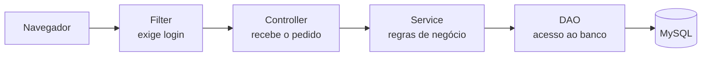
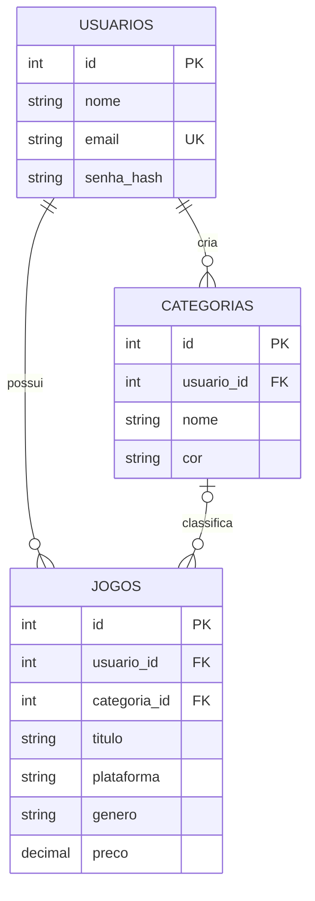

<div align="center">

# 🩸 Arquivo Paranormal

### Acervo de jogos com API REST em Java, MySQL e tema de dossiê paranormal


*Cada agente tem o próprio acervo de jogos, com categorias criadas por ele mesmo.*

</div>

---

## 📖 Sobre o projeto

Projeto acadêmico de **Aplicações para Internet (Uniube)**. É uma API RESTful completa em Java, no padrão **MVC** com camadas separadas (Controller, Service e DAO), que permite ao usuário se cadastrar, fazer login e organizar a própria coleção de jogos.

A interface web (HTML, CSS e JavaScript puro) conversa com a API por `fetch` e segue o visual de um dossiê de investigação paranormal, em vermelho e preto.


## ✨ Funcionalidades

- 🔐 **Cadastro e login** com sessão e senha protegida por hash (PBKDF2 + salt)
- 🎮 **CRUD de jogos** (criar, listar, editar e excluir)
- 🏷️ **Categorias personalizadas**: cada usuário cria, renomeia, colore e exclui as suas
- 🔎 **Busca e filtros** por texto, plataforma e categoria
- 📊 **Estatísticas** do acervo: total de registros, valor, preço médio e categorias
- 👤 **Dados isolados**: cada usuário só enxerga o que é dele

## 🧱 Arquitetura



| Camada | Responsabilidade | Classes |
|---|---|---|
| **Controller** | Recebe a requisição HTTP e devolve JSON | `JogoController`, `CategoriaController`, `AuthController` |
| **Service** | Validações e regras de negócio | `JogoService`, `CategoriaService`, `UsuarioService` |
| **DAO** | Comandos SQL com `PreparedStatement` | `JogoDAO`, `CategoriaDAO`, `UsuarioDAO` |
| **Model** | Entidades | `Jogo`, `Categoria`, `Usuario` |
| **Filter** | Bloqueia rotas sem login (401) | `AuthFilter` |

## 🗄️ Banco de dados



## 🗂️ Estrutura de pastas

```
demo/
├── pom.xml
├── schema.sql
└── src/main
    ├── java/br/com/jogos
    │   ├── controller/  config/  dao/  filter/
    │   ├── model/       service/  util/
    └── webapp
        ├── login.html   app.html
        ├── css/   js/   WEB-INF/web.xml
```

## 🚀 Como rodar

**Pré-requisitos:** JDK 17, Maven, Tomcat 9 e MySQL (ou XAMPP).

```bash
# 1. Crie o banco
#    execute demo/schema.sql no MySQL

# 2. (opcional) se o seu MySQL tiver senha
#    defina as variáveis DB_USER, DB_PASS e DB_URL

# 3. Gere o pacote
cd demo
mvn clean package

# 4. Copie target/biblioteca-jogos.war para a pasta webapps do Tomcat 9 e inicie o Tomcat
```

Acesse: **http://localhost:8080/biblioteca-jogos/**

## 🔌 Documentação da API

Todas as respostas são JSON. Erros vêm como `{"erro": "mensagem"}`. As rotas de jogos e categorias exigem login (sem sessão: `401`) e trabalham só com os dados do usuário logado.

### Autenticação

| Método | Rota | Corpo | Status |
|---|---|---|---|
| `POST` | `/api/auth/register` | `{"nome","email","senha"}` | 201, 400, 409 |
| `POST` | `/api/auth/login` | `{"email","senha"}` | 200, 401 |
| `POST` | `/api/auth/logout` | n/a | 204 |
| `GET` | `/api/auth/me` | n/a | 200, 401 |

### Jogos

| Método | Rota | Descrição | Status |
|---|---|---|---|
| `GET` | `/api/jogos` | Lista os jogos do usuário | 200 |
| `GET` | `/api/jogos/{id}` | Busca um jogo | 200, 404 |
| `POST` | `/api/jogos` | Cadastra | 201, 400 |
| `PUT` | `/api/jogos/{id}` | Atualiza | 200, 400, 404 |
| `DELETE` | `/api/jogos/{id}` | Exclui | 204, 404 |

```json
{ "titulo": "Hollow Knight", "plataforma": "PC", "genero": "Metroidvania", "preco": 46.99, "categoriaId": 3 }
```

### Categorias

| Método | Rota | Descrição | Status |
|---|---|---|---|
| `GET` | `/api/categorias` | Lista as categorias do usuário | 200 |
| `POST` | `/api/categorias` | Cria | 201, 400, 409 |
| `PUT` | `/api/categorias/{id}` | Renomeia ou muda a cor | 200, 400, 404, 409 |
| `DELETE` | `/api/categorias/{id}` | Exclui (os jogos ficam sem categoria) | 204, 404 |

```json
{ "nome": "Terror", "cor": "#c1121f" }
```

## 🔒 Segurança

- Senhas com **PBKDF2 + salt**, nunca em texto puro
- **PreparedStatement** em todas as consultas (sem SQL Injection)
- Toda consulta filtra pelo dono do registro (`usuario_id`), que vem da sessão e nunca do JSON
- HTML escapado no front (sem XSS)
- Conexões fechadas com `try-with-resources`

## 👥 Autores

- **Samantha** ([@SamanthaSec](https://github.com/SamanthaSec))

---

<div align="center">

*Projeto acadêmico, Uniube.* 🩸

</div>
